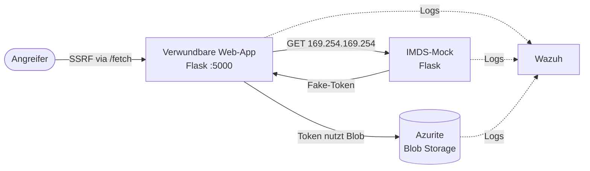
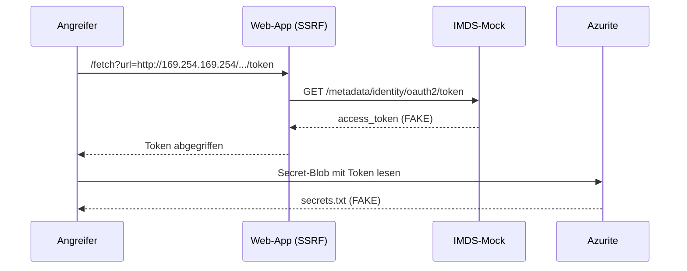

# Cloud Attack & Defense Lab

Ein praktisches Lab, das eine typische Cloud-Angriffskette nachstellt — **SSRF → Instance Metadata Service (IMDS) → gestohlenes Managed-Identity-Token → Zugriff auf Cloud-Storage** — diese dann mit **Wazuh erkennt** (zugeordnet nach MITRE ATT&CK) und am Ende **behebt**. Alles auf einer einzelnen Ubuntu-VM.

## Szenario

Eine öffentlich erreichbare Web-App hat eine SSRF-Lücke. Ein Angreifer nutzt sie, um den Metadaten-Dienst der VM zu erreichen, stiehlt das Managed-Identity-Token und liest damit ein Secret aus dem Storage. Jede Komponente wird lokal emuliert:

| Echtes Azure | Emulation im Lab |
|---|---|
| Azure Blob Storage | Azurite (offizieller Storage-Emulator) |
| Instance Metadata Service (169.254.169.254) | Flask-"IMDS-Mock", liefert ein Fake-Token |
| Öffentliche Web-App mit SSRF | Flask-App mit absichtlicher SSRF-Lücke |
| SIEM (Log-Auswertung) | Wazuh (selbst gehostet) |

## Architektur



## Angriffskette



## MITRE ATT&CK

| Schritt | Technik | ID |
|---|---|---|
| SSRF in die App | Exploit Public-Facing Application | T1190 |
| Token aus IMDS stehlen | Unsecured Credentials: Cloud Instance Metadata API | T1552.005 |
| Gestohlene Identität nutzen | Valid Accounts: Cloud Accounts | T1078.004 |

## Ordnerstruktur

```
cloud-attack-defense-lab/
├── notes/        # Hintergrund-Notizen (SSRF, IMDS, Managed Identity, Azurite)
├── infra/        # docker-compose + Seed für die Lab-Umgebung
├── imds-mock/    # Flask-Dienst, der den Metadaten-Endpunkt nachbaut
├── webapp/       # Flask-App mit der absichtlichen SSRF-Lücke
├── attack/       # Angriffsskripte (Woche 2)
├── detection/    # Wazuh-Regeln & Erkennung (Woche 2)
└── screenshots/  # Belege für jede Phase
```

## Status

- [x] Woche 1 - Setup: Tooling, Repo, Notizen, Lab-Dienste
- [ ] Woche 2 - Angriff & Erkennung: Kette ausführen, Wazuh-Regeln, Alarme
- [ ] Woche 3 - Behebung & Doku: SSRF-Fix, Least Privilege, Vorher/Nachher
